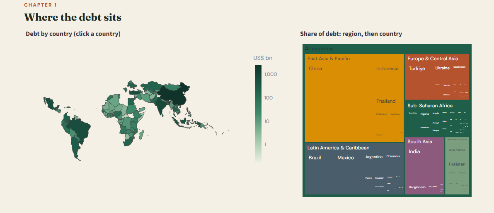
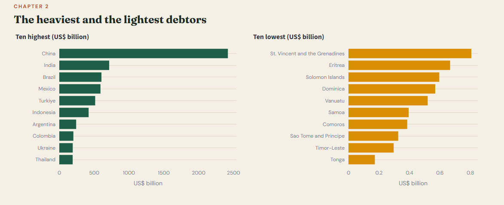
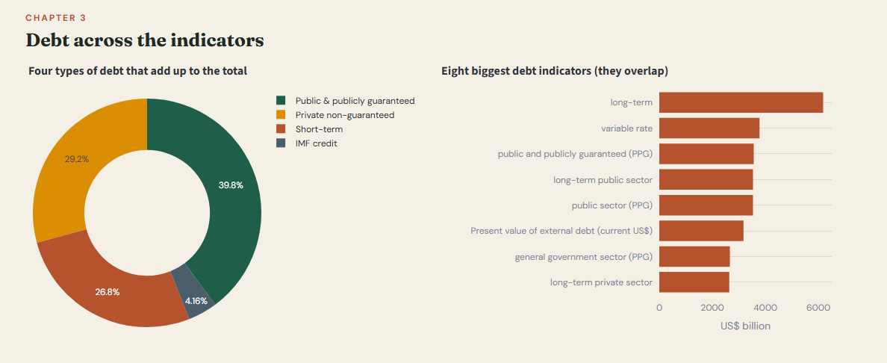
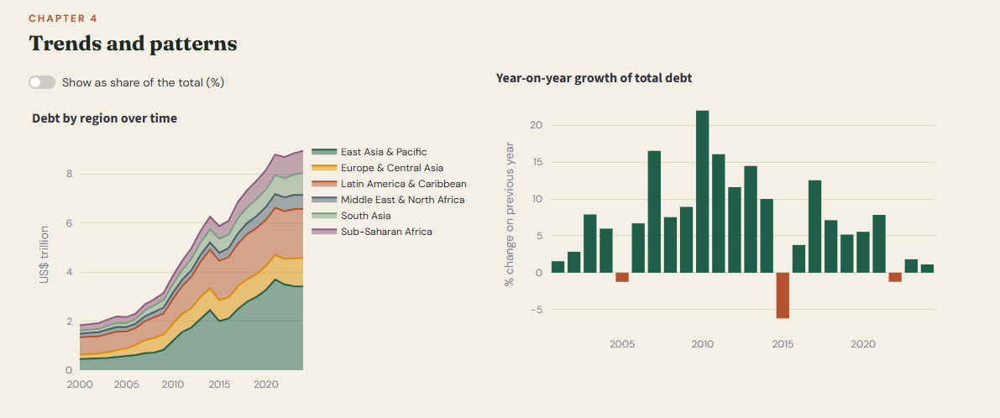
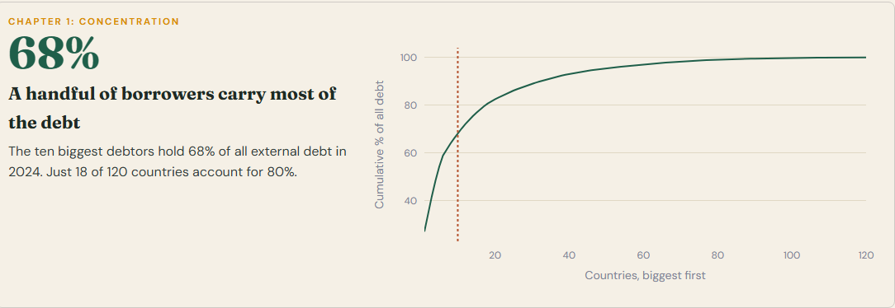
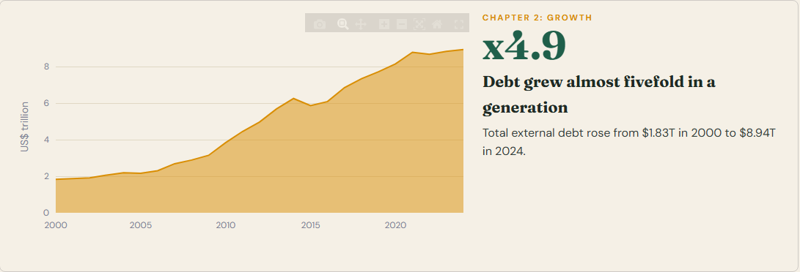
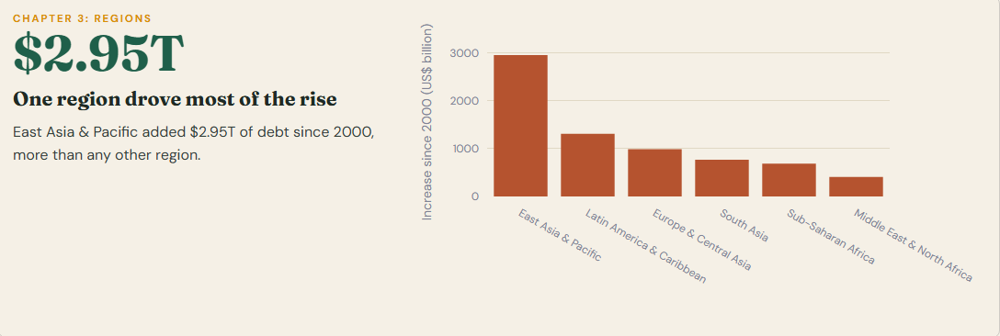
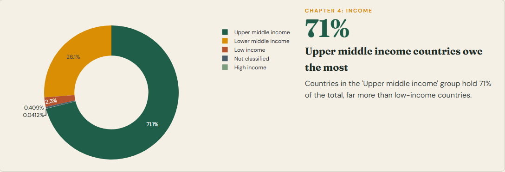
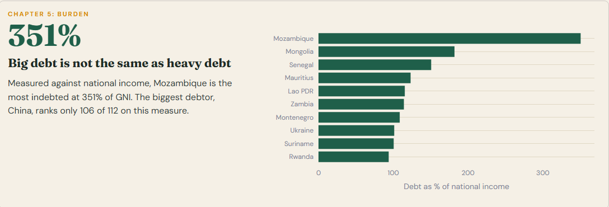

# International Debt Analysis (Debt Compass)

An end-to-end data analytics project on World Bank international debt data: cleaning and EDA in Python, a normalised MySQL database with 30 analytical SQL queries, and an interactive Streamlit dashboard.

**Domain:** Finance analytics and global economic data analysis
**Tools:** Python (pandas, Plotly, Seaborn, Matplotlib), MySQL 8, Streamlit

## Problem and objective

Debt data from the World Bank comes as a large, wide CSV with hundreds of indicators and one column per year. It is hard to read, mixes real countries with regional totals, and has gaps. This project turns it into a clean relational database and a dashboard that answers:

- How is debt distributed across countries?
- Which countries have the highest and lowest debt?
- How is debt spread across different indicators?
- What trends and patterns appear over time?

## Screenshots

### Atlas: the one-page picture

**Chapter 1: where the debt sits** (world map and treemap)


**Chapter 2: the heaviest and the lightest debtors**


**Chapter 3: debt across the indicators**


**Chapter 4: trends and patterns**


### Stories: one idea per chapter







## Pipeline

```
Raw CSV files  ->  clean_data.py  ->  cleaned CSVs  ->  load_to_mysql.py  ->  MySQL (3 tables)
                                                                              |
                         eda.py (charts, report)   <--  views.sql, queries.sql (30 queries)
                                                                              |
                                                                      app.py (Streamlit)
```

## Dataset

World Bank International Debt Statistics (updated December 2025). The main file has 62,978 rows (134 countries by 576 indicators) with one column per year from 2000 to 2032.

| File | What it holds |
|---|---|
| `IDS_ALLCountries_Data.csv` | Values for each country, indicator and year |
| `IDS_CountryMetaData.csv` | Region and income group of each country |
| `IDS_SeriesMetaData.csv` | Name and topic of each indicator |

## Data cleaning (clean_data.py)

| Problem | Fix |
|---|---|
| File is not UTF-8 | Read with latin-1 encoding |
| 5 junk rows at the end of the file | Dropped rows with no indicator code |
| Country codes padded with spaces, so joins failed | Stripped spaces from codes and names |
| Hidden non-breaking spaces in names | Replaced with normal spaces |
| Counterpart column was "World" on every row | Dropped the column |
| One column per year | Reshaped to rows: country, indicator, year, value |
| 35% of year cells empty | Dropped empty cells (no values invented) |
| Years 2025 to 2032 are projections | Kept actual years 2000 to 2024 |
| 14 regional groups (for example "IDA total") mixed with countries | Flagged with `is_aggregate = 1` and excluded from totals and rankings |
| About 133,000 negative values | Kept: they are valid net flows |

Result: 1,246,935 clean country-indicator-year values, with no duplicates and no missing values.

## Database design (schema.sql)

```
countries (country_code PK, country_name, region, income_group, is_aggregate)
indicators (indicator_code PK, indicator_name, topic, unit)
debt_data (country_code FK, indicator_code FK, year, value)   PK = country_code + indicator_code + year
```

- Parent tables load first so the foreign keys are satisfied.
- `DECIMAL(24,4)` stores exact money values. Negative values are allowed.
- Indexes on `(indicator_code, year)` and `year` speed up the queries.
- Names are stored once in the lookup tables, so the design is normalised.

## How debt is measured

The 576 indicators use different units, so they cannot be added together. **Debt** here means total external debt stocks (`DT.DOD.DECT.CD`) in current US$, for the 120 real countries, using the latest year (2024) for totals and rankings. Total debt splits into four non-overlapping types: public and publicly guaranteed, private non-guaranteed, short-term, and IMF credit.

## SQL queries (views.sql, queries.sql)

30 queries: 10 basic, 10 intermediate and 10 advanced. They use joins, aggregations, subqueries, CTEs, window functions (`RANK`, `ROW_NUMBER`, `SUM() OVER`), `CASE` and a view. Views keep the debt definition in one place. Run them all with `python run_queries.py`. Results are saved in `query_results/`.

## Dashboard (app.py)

| Tab | What it shows |
|---|---|
| Atlas | One page with the key charts: world map and treemap, ten highest and lowest debtors, debt types and indicators, trends by region. Click a bar to open a country spotlight. |
| Stories | Five short chapters (concentration, growth, regions, income, debt burden) with text built from the data |
| Country | Animated bubble chart (debt, burden and repayments by year) and a country comparison |
| Indicator | Explore any of 538 US$ indicators, with side by side, tabs or stacked layouts |
| SQL | Run any of the 30 queries and download the result |

## Key findings

- The ten biggest debtors hold 68.2% of all external debt, and China alone holds 27%.
- Total debt grew from 1.83 trillion US$ in 2000 to 8.94 trillion US$ in 2024 (about 4.9 times). It fell only in 2005, 2015 and 2022.
- East Asia and Pacific holds the most debt (3.41 trillion US$). Upper middle income countries hold 71% of the total.
- Public and publicly guaranteed debt is the largest type (3.56 trillion US$).
- Size is not burden: Mozambique has the heaviest debt compared with national income (351% of GNI), while China ranks 106th of 112.

The full analysis is in `docs/EDA_Report.docx`.

## How to run

1. Install MySQL 8 and Python 3.10 or newer.
2. Install the packages: `pip install -r requirements.txt`
3. Put the three raw CSV files in the project folder.
4. Clean the data: `python clean_data.py`
5. Create the database and load it: `python load_to_mysql.py` (asks for your MySQL password)
6. Create the views: `python create_views.py`
7. Optional: run all 30 queries: `python run_queries.py`
8. Optional: create the EDA charts: `python eda.py`
9. Open `db.py` and replace `YOUR_MYSQL_PASSWORD` with your MySQL password.
10. Start the dashboard: `streamlit run app.py`

## Project structure

| File | Purpose |
|---|---|
| `clean_data.py` | Cleaning and reshaping |
| `eda.py` | Statistics, findings and charts |
| `schema.sql`, `load_to_mysql.py` | MySQL tables and the loader |
| `views.sql`, `create_views.py` | Views used by the queries |
| `queries.sql`, `run_queries.py` | The 30 queries and a runner |
| `sql_utils.py`, `db.py` | Database helpers |
| `app.py` | Streamlit dashboard |
| `docs/EDA_Report.docx` | EDA report |
| `eda_charts/`, `query_results/`, `screenshots/` | Charts, saved query results, screenshots |

## Limitations

- Totals are year-end stocks in current US$, so exchange rate and price changes affect comparisons across years.
- Fewer countries report in early years, so early growth rates are less comparable.
- Projections (2025 to 2032) are left out, so the analysis describes the past.
- The debt-stock indicators overlap, so their shares show relative size, not a split of the total.
- The password in `db.py` is a placeholder. A real deployment should use environment variables or a secrets manager.

## Author

Sanjay G Sajan | [GitHub](https://github.com/sanjaygsajan04-collab)
